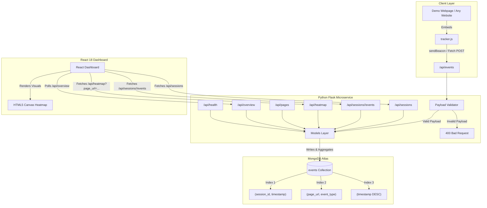

# CausalPulse — Full-Stack User Analytics & Click Heatmap Platform

[](https://www.python.org/)
[](https://palletsprojects.com/p/flask/)
[](https://react.dev/)
[](https://vitejs.dev/)
[](https://www.mongodb.com/)
[](https://docs.pytest.org/)

A miniature, privacy-conscious user interaction analytics platform. It automatically tracks visitor sessions and page interactions, stores high-resolution event data in MongoDB using schema-indexed pipelines, and renders real-time session flows and visual click heatmaps inside an interactive React dashboard.

---

## 📑 Table of Contents

- [1. Project Overview](#1-project-overview)
- [2. System Architecture & Data Flow](#2-system-architecture--data-flow)
- [3. Key Features](#3-key-features)
- [4. Technology Stack](#4-technology-stack)
- [5. Repository Structure](#5-repository-structure)
- [6. Prerequisites](#6-prerequisites)
- [7. Local Setup & Quickstart](#7-local-setup--quickstart)
- [8. Environment Variables](#8-environment-variables)
- [9. MongoDB Data Model & Indexes](#9-mongodb-data-model--indexes)
- [10. REST API Documentation](#10-rest-api-documentation)
- [11. Client-Side Tracking Script Guide](#11-client-side-tracking-script-guide)
- [12. Testing Suite](#12-testing-suite)
- [13. Deployment Guide](#13-deployment-guide)
- [14. Assumptions, Trade-offs & Security](#14-assumptions-trade-offs--security)
- [15. Interview Guide: Explaining the Architecture](#15-interview-guide-explaining-the-architecture)

---

## 1. Project Overview

**CausalPulse** is designed to provide end-to-end visibility into how users interact with web applications without capturing sensitive personal data or relying on bloated third-party tracking scripts.

The platform consists of four distinct components:
1. **Lightweight Tracker (`tracker.js`)**: An autonomous, vanilla JavaScript tracking library with zero dependencies. Automatically generates unique persistent sessions, records `page_view` events, and logs coordinate-accurate `click` events with viewport dimensions.
2. **Interactive Demo Site (`demo/index.html`)**: A multi-section landing page with navigation links, call-to-action buttons, pricing cards, and interactive widgets to simulate visitor traffic.
3. **Flask REST API (`backend/`)**: A modular Python microservice built with the Application Factory pattern. Validates incoming telemetry payloads, manages MongoDB connection lifecycles, and computes high-performance analytical aggregates directly inside database aggregation pipelines.
4. **React Analytics Dashboard (`dashboard/`)**: A reactive, dark-themed analytics console built with React 18, Vite, and custom CSS. Features real-time KPI cards, searchable session tables, chronological visitor journeys, and an HTML5 Canvas click heatmap with normalization and wireframe overlays.

---

## 2. System Architecture & Data Flow



### End-to-End Data Flow Sequence:
1. When a user lands on an instrumented webpage, `tracker.js` reads or initializes a UUID session token in `localStorage`.
2. A `page_view` event payload is dispatched to `POST /api/events` with the current URL, viewport width, viewport height, and ISO 8601 timestamp.
3. User clicks anywhere on the webpage capture normalized `clientX` / `clientY` coordinates, screen dimensions, and dispatch a `click` event without interrupting user interactions.
4. Flask validates data types and required fields, inserting documents into MongoDB with pre-created compound indexes.
5. The React Dashboard polls or fetches aggregate statistics via MongoDB pipelines and visualizes clicks projected onto the viewport dimensions.

---

## 3. Key Features

- **Autonomous Session Persistence**: Sessions survive page refreshes, tab switches, and internal site navigation via browser `localStorage` and `crypto.randomUUID()`.
- **Non-blocking Event Delivery**: Employs `navigator.sendBeacon` for asynchronous, non-blocking telemetry transmission that persists even when navigating away from the page, with seamless fallback to `fetch(..., { keepalive: true })`.
- **Privacy by Design**: Collects zero PII (Personally Identifiable Information), passwords, form values, or cookies. Only stores interaction coordinates and metadata.
- **Server-Side Aggregations**: The sessions list, event distributions, and dashboard overview metrics are executed in MongoDB's aggregation engine (`$group`, `$facet`, `$sort`), avoiding fetching millions of raw events into Python memory.
- **HTML5 Canvas Heatmap Engine**:
  - Automatically scales recorded coordinates relative to the user's recorded viewport dimensions (`(x / viewport_width) * canvas_width`).
  - Offscreen radial density rendering with multi-stop thermal gradients (blue $\to$ cyan $\to$ lime $\to$ yellow $\to$ orange $\to$ red).
  - Built-in website wireframe underlay to clearly align clicks with headers, buttons, cards, and footers.
  - Interactive inspection tooltip showing coordinates and timestamps on hover.
  - Live adjustment controls for heat radius and opacity intensity.
- **Chronological User Journey**: Inspect any selected session to inspect its complete step-by-step audit trail with visual distinctions between page views and clicks.

---

## 4. Technology Stack

| Layer | Technology | Justification |
|---|---|---|
| **Frontend** | React 18, Vite 5, JavaScript | Modern component architecture, ultra-fast HMR and bundling |
| **Styling** | Vanilla CSS (CSS Custom Properties) | Native control, zero runtime overhead, responsive layout |
| **Heatmap Engine** | Native HTML5 Canvas 2D API | Zero external library dependencies, high-performance pixel-level rendering |
| **Backend** | Python 3.10+, Flask 3.1 | Explicit requirement, lightweight REST microservice with Blueprint isolation |
| **Database** | MongoDB (Atlas or Local v6.0+) | Document-oriented storage optimal for event streams and aggregation pipelines |
| **Tracker** | Vanilla JavaScript (ES6 IIFE) | Standalone, lightweight (<2KB), framework-agnostic embeddability |
| **Testing** | Pytest, Requests | Automated unit tests and comprehensive end-to-end integration flows |

---

## 5. Repository Structure

```
submission/
├── backend/                        # Python Flask REST API
│   ├── app/
│   │   ├── __init__.py             # Flask App Factory & CORS/Index setup
│   │   ├── config.py               # Environment configuration with python-dotenv
│   │   ├── models.py               # MongoDB database layer & aggregation pipelines
│   │   ├── validators.py           # Request payload schema validation
│   │   └── routes/
│   │       ├── __init__.py
│   │       ├── events.py           # POST /api/events
│   │       ├── sessions.py         # GET /api/sessions & GET /api/sessions/<id>/events
│   │       └── heatmap.py          # GET /api/heatmap & GET /api/pages
│   ├── tests/
│   │   ├── __init__.py
│   │   ├── conftest.py             # Pytest application fixture
│   │   ├── test_events.py          # Event ingestion & validation unit tests
│   │   ├── test_sessions.py        # Session list & journey unit tests
│   │   ├── test_heatmap.py         # Heatmap filtering unit tests
│   │   └── test_e2e_flow.py        # End-to-end multi-step verification test
│   ├── requirements.txt            # Python dependencies
│   ├── .env.example                # Template configuration (no secrets)
│   └── run.py                      # Development server runner
│
├── tracker/                        # Standalone telemetry tracking script
│   └── tracker.js                  # Autonomous client-side tracker
│
├── demo/                           # Tracking testbed page
│   ├── index.html                  # Multi-component demo page
│   └── styles.css                  # Modern UI styles for the demo page
│
├── dashboard/                      # React 18 Analytics Dashboard
│   ├── public/
│   ├── src/
│   │   ├── api/
│   │   │   └── analytics.js        # REST API client
│   │   ├── components/
│   │   │   ├── Navbar.jsx          # Header, tabs, and live health status
│   │   │   ├── Overview.jsx        # KPI metric cards & real-time activity feed
│   │   │   ├── SessionList.jsx     # Searchable, filterable sessions table
│   │   │   ├── UserJourney.jsx     # Chronological session event timeline
│   │   │   └── Heatmap.jsx         # HTML5 Canvas visual click heatmap
│   │   ├── App.jsx                 # Application shell & polling controller
│   │   ├── App.css                 # Component styling & layouts
│   │   ├── index.css               # Global theme tokens & resets
│   │   └── main.jsx                # React root mount
│   ├── index.html                  # HTML entry point with metadata
│   ├── vite.config.js              # Vite configuration
│   └── package.json                # Frontend dependencies
│
├── .gitignore                      # Git ignore rules for Python, Node & envs
└── README.md                       # Complete documentation
```

---

## 6. Prerequisites

Ensure you have the following installed locally:
- **Python**: Version 3.10, 3.11, or 3.12 (`python --version`)
- **Node.js**: Version 18.x or 20.x (`node --version`)
- **npm**: Version 9.x or 10.x (`npm --version`)
- **MongoDB**: Either a local MongoDB instance (`localhost:27017`) or a free [MongoDB Atlas](https://www.mongodb.com/cloud/atlas) cluster.

---

## 7. Local Setup & Quickstart

Clone the repository and follow the three simple setup steps below:

### Step 1: Backend Setup (Flask + MongoDB)

```bash
# Navigate to backend directory
cd backend

# Create Python virtual environment
python -m venv venv

# Activate virtual environment
# Windows (PowerShell):
.\venv\Scripts\Activate.ps1
# macOS / Linux:
# source venv/bin/activate

# Install dependencies
pip install -r requirements.txt

# Create your .env file from the example
cp .env.example .env

# Edit .env with your MongoDB Atlas or local connection string:
# MONGO_URI=mongodb+srv://<username>:<password>@cluster.mongodb.net/?retryWrites=true&w=majority
# MONGO_DB_NAME=user_analytics

# Run the Flask backend
python run.py
```
> The API will be available at `http://localhost:5000`  
> Health check: `http://localhost:5000/api/health`

---

### Step 2: Serve the Demo Webpage & Tracker

Open a second terminal window in the project root:

```bash
# From the repository root
python -m http.server 5500
```
> Open `http://localhost:5500/demo/index.html` in your browser.  
> Click buttons, navigation links, and pricing cards to generate live tracking events!

---

### Step 3: Frontend Dashboard Setup (React + Vite)

Open a third terminal window:

```bash
# Navigate to dashboard directory
cd dashboard

# Install dependencies
npm install

# Start Vite development server
npm run dev
```
> Open `http://localhost:5173` to access the CausalPulse Analytics Dashboard!

---

## 8. Environment Variables

The backend uses environment variables loaded securely via `python-dotenv`. Credentials and secrets are **never** committed to version control.

### `backend/.env.example`
```ini
# MongoDB Connection String (Atlas URI or local instance)
MONGO_URI=mongodb+srv://<username>:<password>@cluster.mongodb.net/?retryWrites=true&w=majority

# Database name to store collections
MONGO_DB_NAME=user_analytics

# Allowed CORS origins (comma-separated)
CORS_ORIGINS=http://localhost:5173,http://localhost:3000,http://127.0.0.1:5500,null

# Flask Runtime Configuration
FLASK_ENV=development
FLASK_DEBUG=1
PORT=5000
```

---

## 9. MongoDB Data Model & Indexes

### Document Structure (`events` collection)

Each interaction represents an atomic document:

```json
{
  "_id": { "$oid": "6acc937a4b8a006d050adc92" },
  "session_id": "sess_2b0db625-f712-4e08-9a67-d860d5e9b891",
  "event_type": "click",
  "page_url": "http://localhost:5500/demo/index.html",
  "timestamp": "2026-10-12T08:00:10.450Z",
  "x": 450,
  "y": 320,
  "viewport_width": 1440,
  "viewport_height": 900
}
```

### Field Definitions & Purpose

| Field | Data Type | Purpose | Nullable |
|---|---|---|---|
| `_id` | ObjectId | MongoDB unique document identifier | No |
| `session_id` | String | Persistent identifier linking multiple interactions to a single user session | No |
| `event_type` | String | Type of event: strictly restricted to `"page_view"` or `"click"` | No |
| `page_url` | String | Canonical URL of the webpage where the interaction took place | No |
| `timestamp` | String (ISO 8601) | Precise UTC timestamp of the interaction | No |
| `x` | Number | Horizontal click coordinate relative to the client viewport | Yes (null on `page_view`) |
| `y` | Number | Vertical click coordinate relative to the client viewport | Yes (null on `page_view`) |
| `viewport_width` | Number | Browser inner window width at the moment of interaction | No |
| `viewport_height` | Number | Browser inner window height at the moment of interaction | No |

### Indexes & Performance Rationale

```python
# 1. User Journey Lookup: Fast lookup of events per session, ordered chronologically
collection.create_index([("session_id", 1), ("timestamp", 1)], name="idx_session_timestamp")

# 2. Heatmap Queries: High-speed filtering of clicks on a target page
collection.create_index([("page_url", 1), ("event_type", 1)], name="idx_page_event_type")

# 3. Recent Activity Feed: Quick retrieval of the latest events
collection.create_index([("timestamp", -1)], name="idx_timestamp_desc")
```

---

## 10. REST API Documentation

### 1. `GET /api/health`
Checks API status and pings MongoDB.
- **Response `200 OK`**:
```json
{
  "database": "connected",
  "status": "healthy"
}
```

---

### 2. `POST /api/events`
Ingests a single tracking event.

- **Request Body (Click Event)**:
```json
{
  "session_id": "sess_test_123",
  "event_type": "click",
  "page_url": "http://localhost:5500/demo/index.html",
  "timestamp": "2026-10-12T08:00:10.000Z",
  "x": 450,
  "y": 320,
  "viewport_width": 1440,
  "viewport_height": 900
}
```
- **Response `201 Created`**:
```json
{
  "event_id": "6acc820f891e391a65f4d0e3",
  "message": "Event recorded."
}
```
- **Response `400 Bad Request`**:
```json
{
  "error": "click events require the field: x"
}
```

---

### 3. `GET /api/sessions`
Returns a summary list of all distinct sessions, aggregated directly inside MongoDB.

- **Response `200 OK`**:
```json
{
  "count": 2,
  "sessions": [
    {
      "clicks": 3,
      "last_activity": "2026-10-12T08:00:12.100Z",
      "page_views": 1,
      "session_id": "sess_e2e_2b0db625",
      "total_events": 4
    }
  ]
}
```

---

### 4. `GET /api/sessions/<session_id>/events`
Returns all chronological events for a single session.

- **Response `200 OK`**:
```json
{
  "count": 2,
  "session_id": "sess_test_123",
  "events": [
    {
      "event_type": "page_view",
      "page_url": "http://localhost:5500/demo/index.html",
      "session_id": "sess_test_123",
      "timestamp": "2026-10-12T06:45:22.461Z",
      "viewport_height": 900,
      "viewport_width": 1440,
      "x": null,
      "y": null
    },
    {
      "event_type": "click",
      "page_url": "http://localhost:5500/demo/index.html",
      "session_id": "sess_test_123",
      "timestamp": "2026-10-12T06:45:33.389Z",
      "viewport_height": 900,
      "viewport_width": 1440,
      "x": 450,
      "y": 320
    }
  ]
}
```
- **Response `404 Not Found`**:
```json
{
  "error": "No events found for session: unknown_session_id"
}
```

---

### 5. `GET /api/heatmap?page_url=<url>`
Returns coordinate and viewport data for click heatmap rendering.

- **Query Parameters**:
  - `page_url` (required, string): URL to filter clicks for.
- **Response `200 OK`**:
```json
{
  "count": 3,
  "page_url": "http://localhost:5500/demo/index.html",
  "clicks": [
    {
      "timestamp": "2026-10-12T08:00:10.000Z",
      "viewport_height": 900,
      "viewport_width": 1440,
      "x": 450,
      "y": 320
    }
  ]
}
```

---

### 6. `GET /api/pages`
Returns a distinct list of all tracked URLs for populating heatmap dropdown selectors.

- **Response `200 OK`**:
```json
{
  "count": 1,
  "pages": [
    "http://localhost:5500/demo/index.html"
  ]
}
```

---

### 7. `GET /api/overview`
Returns high-level aggregate KPI statistics and latest event stream via MongoDB `$facet`.

- **Response `200 OK`**:
```json
{
  "clicks": 18,
  "page_views": 5,
  "total_events": 23,
  "total_sessions": 4,
  "recent_activity": [
    {
      "event_type": "click",
      "page_url": "http://localhost:5500/demo/index.html",
      "session_id": "sess_e2e_2b0db625",
      "timestamp": "2026-10-12T08:00:12.100Z"
    }
  ]
}
```

---

## 11. Client-Side Tracking Script Guide

The tracking script (`tracker/tracker.js`) is completely independent of React and has zero external dependencies.

### Embedding on Any Webpage

Simply include the script tag before the closing `</body>` tag on any HTML page:

```html
<!-- Embed Tracking Script -->
<script 
  src="https://your-domain.com/tracker.js" 
  data-api-url="https://your-flask-api.com"
></script>
```

### Configuration Options
- **`data-api-url`**: Specify your backend API host URL. Defaults to `http://localhost:5000` if omitted.

### Key Implementation Techniques
- **IIFE Scope Isolation**: Wrapped in an immediately invoked function expression to prevent polluting the host webpage's global scope.
- **Double-Initialization Guard**: `window.__analytics_tracker_loaded` protects against accidental multiple script embeds.
- **Graceful Error Handling**: All network dispatches and `localStorage` interactions are enclosed in silent `try/catch` blocks so host webpages never crash if the API is unreachable.
- **Passive Listeners**: `{ passive: true }` ensures click listeners never block scroll or user interaction rendering pipelines.

---

## 12. Testing Suite

The repository includes both automated unit tests and an end-to-end integration test.

### Running Pytest Unit Tests
From the `backend/` directory:

```bash
cd backend
.\venv\Scripts\pytest.exe -v
```

Expected output:
```
tests/test_events.py::test_health_check PASSED                           [ 10%]
tests/test_events.py::test_post_valid_page_view PASSED                   [ 20%]
tests/test_events.py::test_post_valid_click PASSED                       [ 30%]
tests/test_events.py::test_post_invalid_event_type PASSED                [ 40%]
tests/test_events.py::test_post_missing_fields PASSED                    [ 50%]
tests/test_events.py::test_post_click_missing_coordinates PASSED         [ 60%]
tests/test_heatmap.py::test_heatmap_and_pages PASSED                     [ 70%]
tests/test_heatmap.py::test_heatmap_missing_param PASSED                 [ 80%]
tests/test_sessions.py::test_sessions_list_and_journey PASSED            [ 90%]
tests/test_sessions.py::test_session_events_not_found PASSED             [100%]
============================== 10 passed in 2.31s ==============================
```

### Running End-to-End Lifecycle Verification
With Flask running on port 5000:

```bash
cd backend
.\venv\Scripts\python.exe tests/test_e2e_flow.py
```

Validates:
1. Health check & MongoDB ping
2. Page view ingestion
3. Click ingestion with coordinates
4. Session aggregation & count matching
5. Chronological journey sequence verification
6. Heatmap coordinate verification
7. 400 bad request & 404 not found error handling

---

## 13. Deployment Guide

### A. Database (MongoDB Atlas)
1. Create a free shared M0 cluster at [MongoDB Atlas](https://www.mongodb.com/cloud/atlas).
2. Create a Database User with read/write privileges.
3. Under **Network Access**, whitelist your IP or allow access from anywhere (`0.0.0.0/0`).
4. Copy the SRV URI into `MONGO_URI`.

### B. Backend (Render / Railway / Fly.io)
1. Connect your GitHub repository to [Render](https://render.com) or [Railway](https://railway.app).
2. Configure environment:
   - **Build Command**: `pip install -r backend/requirements.txt`
   - **Start Command**: `gunicorn -w 2 -b 0.0.0.0:$PORT "app:create_app()"`
   - Add production Gunicorn dependency (`pip install gunicorn`).
3. Set Environment Variables:
   - `MONGO_URI`: Atlas connection string
   - `MONGO_DB_NAME`: `user_analytics`
   - `CORS_ORIGINS`: Your production frontend domain URL (e.g. `https://my-dashboard.vercel.app`)

### C. Frontend (Vercel / Netlify)
1. Connect your repository to [Vercel](https://vercel.com).
2. Set Root Directory to `dashboard`.
3. Set Environment Variable:
   - `VITE_API_URL`: Your deployed backend URL (e.g. `https://my-analytics-api.onrender.com`).
4. Vercel automatically runs `npm run build` and serves the production static bundle.

---

## 14. Assumptions, Trade-offs & Security

### Assumptions
- **Viewport Normalization**: Since visitors browse on differing device resolutions (e.g. 1920x1080 vs 1366x768 vs mobile), click coordinates are normalized as fractions of the recorded viewport width and height before rendering onto the target canvas resolution.
- **Session Lifespan**: Standard web sessions persist in `localStorage` until the user clears browser data. For an enterprise version, session timeouts (e.g. 30 minutes of inactivity) could be computed by comparing successive event timestamps.

### Trade-offs
- **One Document per Event vs Bucket Pattern**: We store one document per event as requested by the assignment. This provides high query flexibility and atomic writes. In ultra-high-throughput systems (billions of events/day), time-series collections or pre-aggregated hourly buckets could be adopted.
- **Vanilla CSS vs TailwindCSS**: Vanilla CSS was utilized for maximum flexibility, bespoke glassmorphic aesthetics, zero build complexity, and compliance with the core project guidelines.
- **No Heavy Chart Libraries**: Native HTML5 Canvas 2D is used for the heatmap instead of heavyweight third-party libraries. This gives complete control over pixel color manipulation and avoids bundle bloat.

### Security & Privacy
- **Strict CORS Policy**: Configurable through `CORS_ORIGINS` to allow only authorized frontend origins to read session data.
- **No PII Collection**: Passwords, input fields, form values, and identifiable headers are never captured.
- **Protection of Secrets**: Real database credentials are isolated in `.env` and omitted from version control via `.gitignore`.

---

## 15. Interview Guide: Explaining the Architecture

When asked to explain this project during technical interviews, highlight these architectural points:

1. **Why Flask with App Factory?**
   - *"I used the Flask Application Factory pattern (`create_app()`) to keep the codebase modular, testable, and maintainable. It allows injecting test configurations (e.g. test database) without altering production code."*

2. **Why MongoDB Aggregation Pipelines instead of Python loops?**
   - *"Rather than pulling thousands of raw event documents into Python memory and computing session statistics in loops (which consumes network bandwidth and CPU), I offloaded computation to MongoDB's `$group` and `$facet` aggregation pipeline. This executes directly at the database layer with indexed performance."*

3. **How does the Heatmap coordinate normalization work?**
   - *"Visitors browse on different screen resolutions. If a user clicks a button at x=720px on a 1440px monitor, that's at 50% width. On an 800px display canvas, we scale it to `(x / viewport_width) * canvas_width` = `(720 / 1440) * 800` = 400px. This ensures clicks accurately align regardless of display dimensions."*

4. **Why `navigator.sendBeacon` in `tracker.js`?**
   - *"Traditional `fetch` requests can be cancelled by the browser if a user closes the tab or navigates away. `navigator.sendBeacon` queues asynchronous POST requests that the browser guarantees will complete in the background without holding up page navigation."*

---

## 📄 License
MIT License. Built as an engineering technical evaluation assignment.
